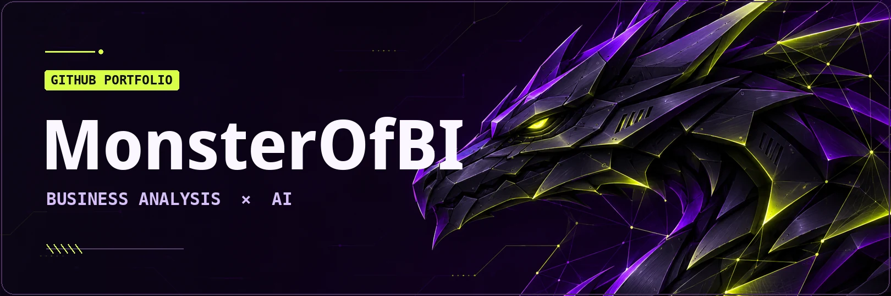
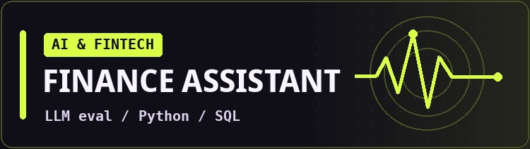
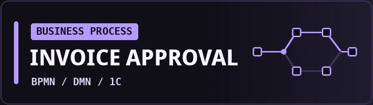
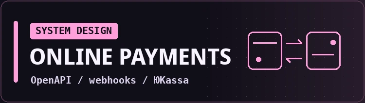
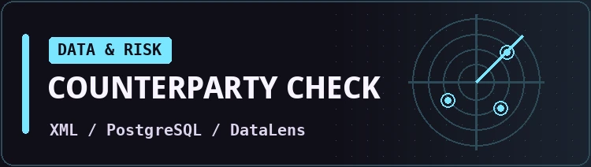

  

<h1 align="center">Максим · Бизнес-аналитика × AI</h1>

  Процессы, требования и интеграции. Учебные кейсы в финтехе и корпоративных финансах. 
  Открыт к стажировке или junior-позиции в бизнес- и системном анализе.

  <a href="#избранное">Избранное</a> · <a href="#все-проекты">Все проекты</a> · <a href="#инструменты">Инструменты</a>

<picture>
  <source media="(prefers-reduced-motion: reduce)" srcset="media/signal-static.png">
  
</picture>

## Избранное

<table>
  <tr>
    <td width="50%" valign="top">
       
      <strong><a href="https://github.com/MonsterOfBI/sme-finance-assistant">Финансовый ассистент для ИП</a></strong> 
      Требования к LLM, набор из 200 размеченных операций и проверка качества базовых правил.
    </td>
    <td width="50%" valign="top">
       
      <strong><a href="https://github.com/MonsterOfBI/invoice-approval-1c">Согласование счетов и 1С</a></strong> 
      Маршрут согласования, контроль дублей, обмен с 1С и сверка банковской выписки.
    </td>
  </tr>
  <tr>
    <td width="50%" valign="top">
       
      <strong><a href="https://github.com/MonsterOfBI/online-payments">Платежи интернет-магазина</a></strong> 
      Контракты платежей и возвратов, webhooks, статусы и защита от повторного списания.
    </td>
    <td width="50%" valign="top">
       
      <strong><a href="https://github.com/MonsterOfBI/counterparty-check">Проверка контрагентов</a></strong> 
      XML → PostgreSQL, объяснимый скоринг и модель кредитного лимита.
    </td>
  </tr>
</table>

> **Контекст кейсов.** Компании вымышленные, данные синтетические или открытые. В кейсе про финпомощника измерено качество базовых правил. Оценочный прогон LLM ещё не проведён.

## Все проекты

### Бизнес-анализ и финтех

| Проект | Что внутри |
| :--- | :--- |
| [Финансовый ассистент для ИП](https://github.com/MonsterOfBI/sme-finance-assistant) | LLM eval / Python / SQL |
| [Согласование счетов и 1С](https://github.com/MonsterOfBI/invoice-approval-1c) | BPMN / DMN / 1С |
| [Платежи интернет-магазина](https://github.com/MonsterOfBI/online-payments) | OpenAPI / webhooks / ЮKassa |
| [Проверка контрагентов](https://github.com/MonsterOfBI/counterparty-check) | XML / PostgreSQL / DataLens |
| [Мини-кейсы бизнес-аналитика](https://github.com/MonsterOfBI/ba-mini-cases) | SQL / API / финансовые модели |

### Веб и розница

| Проект | Что внутри |
| :--- | :--- |
| [ECRU Кабинет](https://github.com/MonsterOfBI/ecru-kabinet) · [Демо](https://ecru-kabinet.vercel.app) | Дашборды / отчёты / рейтинги |
| [testik](https://github.com/MonsterOfBI/testik) · [Демо](https://testik-gray.vercel.app) | Next.js / React / PostgreSQL |

### Игровые проекты

| Проект | Что внутри |
| :--- | :--- |
| [Шаурма-лавка](https://github.com/MonsterOfBI/shawarma-idle) · [Ветка first-version](https://github.com/MonsterOfBI/shawarma-idle/tree/first-version) | Phaser / TypeScript / Vite |
| [Brainrot Waves](https://github.com/MonsterOfBI/brainrot-waves) · [Демо](https://brainrot-waves.vercel.app) | Unity / C# / WebGL |

## Инструменты

| Работа | Где посмотреть |
| :--- | :--- |
| **Процессы и требования** · BPMN, DMN, user stories, критерии приёмки | [TO-BE процесса согласования](https://github.com/MonsterOfBI/invoice-approval-1c/blob/main/bpmn/to-be.png) · [Требования](https://github.com/MonsterOfBI/invoice-approval-1c/blob/main/docs/04_requirements.md) |
| **Системный анализ** · REST, OpenAPI, webhooks, идемпотентность | [Контракт платежей](https://github.com/MonsterOfBI/online-payments/blob/main/api/openapi.yaml) |
| **Данные** · PostgreSQL, CTE, оконные функции, pandas, DataLens | [SQL-бэктест](https://github.com/MonsterOfBI/counterparty-check/tree/main/sql) · [Проект дашборда](https://github.com/MonsterOfBI/counterparty-check/blob/main/dashboard/datalens.md) |
| **Оценка AI-функций** · разметка, эталоны, метрики, ограничения | [Протокол оценки](https://github.com/MonsterOfBI/sme-finance-assistant/blob/main/docs/04_metrics_and_eval.md) |

<strong>Как я работаю с ИИ</strong>

Использую ИИ для симуляции интервью со стейкхолдерами, подготовки синтетических данных и ревью черновиков. Первые версии учебных кейсов собирал вместе с ИИ. В разделах «Как сделано» и файлах `DEFENSE.md` описал, что перепроверял и переделывал сам.

